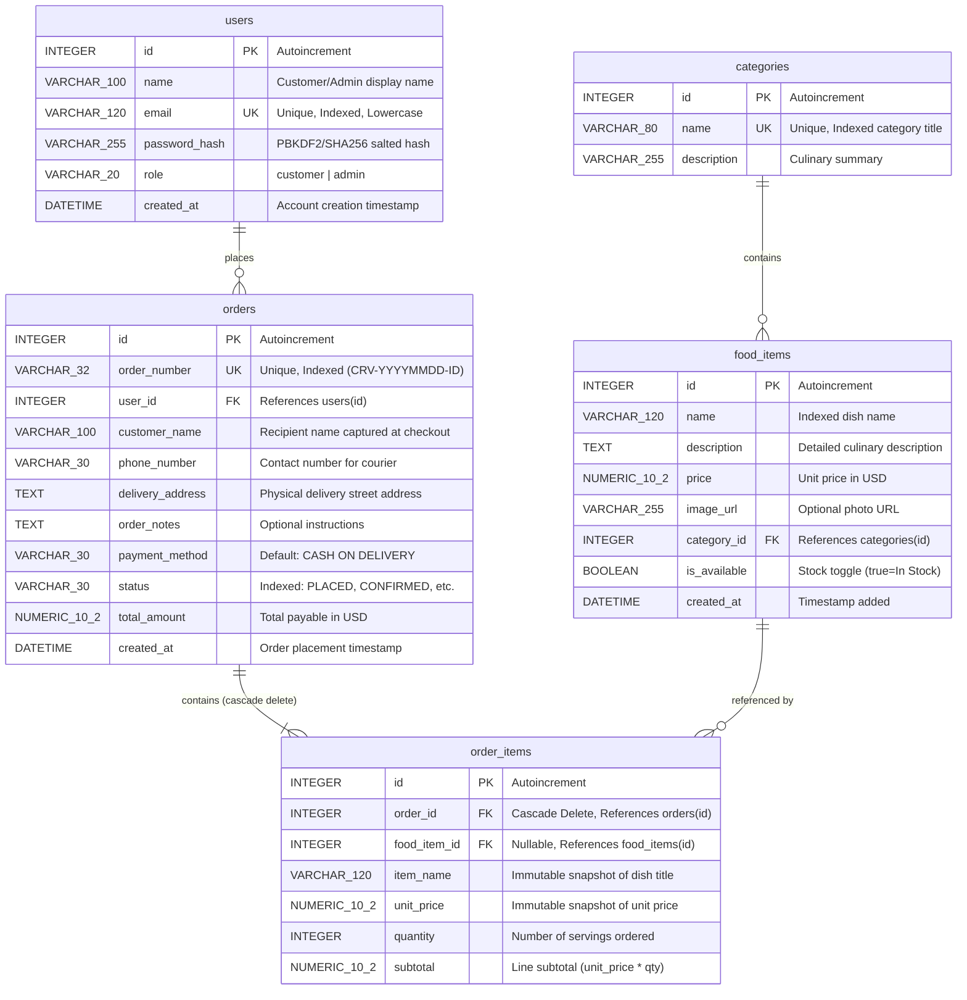

# CraveCart – Database Architecture & Data Dictionary
## Comprehensive Relational Schema Documentation (DATABASE_DOCUMENTATION.md)

---

### 1. Database Overview

CraveCart uses **SQLite 3** managed through **Flask-SQLAlchemy** (SQLAlchemy 2.0+ engine). The schema is normalized (Third Normal Form) and enforces strict primary keys, foreign key constraints, column-level data types, and performance indexes.

- **Engine**: SQLite 3 (stored at `instance/cravecart.db`)
- **Foreign Keys**: Enabled at connection initialization via SQLite PRAGMA (`PRAGMA foreign_keys=ON;`)
- **Monetary Precision**: All currency values use SQL `NUMERIC(10, 2)` mapped to Python `decimal.Decimal` to eliminate binary floating-point rounding errors.
- **Snapshot Architecture**: Completed order line items store immutable copies of dish names and unit prices to preserve legal accounting records if catalog items are subsequently renamed, repriced, or deleted.

---

### 2. Entity-Relationship Diagram



---

### 3. Detailed Data Dictionary

#### 3.1 Table: `users`
Stores customer and administrator credentials and system roles.

| Column Name | SQL Data Type | Nullable | Primary Key | Default | Constraints / Index | Description |
| :--- | :--- | :--- | :--- | :--- | :--- | :--- |
| `id` | `INTEGER` | No | Yes | Auto | Autoincrement | Unique internal user ID |
| `name` | `VARCHAR(100)` | No | No | None | None | Full legal or display name |
| `email` | `VARCHAR(120)` | No | No | None | `UNIQUE`, `INDEXED` | Unique login email (normalized lowercase) |
| `password_hash` | `VARCHAR(255)` | No | No | None | None | PBKDF2-SHA256 salted password hash |
| `role` | `VARCHAR(20)` | No | No | `'customer'` | Value: `'customer'`, `'admin'` | Role-based authorization gatekeeper |
| `created_at` | `DATETIME` | No | No | `CURRENT_TIMESTAMP` | None | UTC account registration timestamp |

- **Foreign Keys**: None.
- **Relationships**:
  - `orders`: One-to-many relationship with `orders.user_id` (`back_populates="user"`).

---

#### 3.2 Table: `categories`
Groups food items into culinary menu sections (e.g., Starters, Mains, Pizzas, Desserts).

| Column Name | SQL Data Type | Nullable | Primary Key | Default | Constraints / Index | Description |
| :--- | :--- | :--- | :--- | :--- | :--- | :--- |
| `id` | `INTEGER` | No | Yes | Auto | Autoincrement | Unique category ID |
| `name` | `VARCHAR(80)` | No | No | None | `UNIQUE`, `INDEXED` | Unique category name |
| `description` | `VARCHAR(255)` | Yes | No | `NULL` | None | Optional description of the section |

- **Foreign Keys**: None.
- **Relationships**:
  - `food_items`: One-to-many relationship with `food_items.category_id` (`back_populates="category"`).
- **Integrity Rule**: Application logic prevents deletion of any category that still has active dishes attached to it.

---

#### 3.3 Table: `food_items`
Represents dishes and culinary offerings on the restaurant menu.

| Column Name | SQL Data Type | Nullable | Primary Key | Default | Constraints / Index | Description |
| :--- | :--- | :--- | :--- | :--- | :--- | :--- |
| `id` | `INTEGER` | No | Yes | Auto | Autoincrement | Unique dish ID |
| `name` | `VARCHAR(120)` | No | No | None | `INDEXED` | Name of the dish |
| `description` | `TEXT` | Yes | No | `NULL` | None | Culinary description and ingredients |
| `price` | `NUMERIC(10, 2)` | No | No | None | Check: `0.01 <= price <= 999.99` | Dish unit price in USD |
| `image_url` | `VARCHAR(255)` | Yes | No | `NULL` | None | Photography URL (uses SVG fallback if null) |
| `category_id` | `INTEGER` | No | No | None | `FOREIGN KEY`, `INDEXED` | References `categories.id` |
| `is_available` | `BOOLEAN` | No | No | `TRUE` | `INDEXED` | Stock status (`1`=In Stock, `0`=Sold Out) |
| `created_at` | `DATETIME` | No | No | `CURRENT_TIMESTAMP` | None | Creation timestamp |

- **Foreign Keys**:
  - `category_id` references `categories(id)` with default restrict.
- **Relationships**:
  - `category`: Many-to-one with `categories` (`back_populates="food_items"`).
  - `order_items`: One-to-many reference link with `order_items.food_item_id`.

---

#### 3.4 Table: `orders`
Master order record capturing fulfillment state, recipient details, and final financial totals.

| Column Name | SQL Data Type | Nullable | Primary Key | Default | Constraints / Index | Description |
| :--- | :--- | :--- | :--- | :--- | :--- | :--- |
| `id` | `INTEGER` | No | Yes | Auto | Autoincrement | Internal numeric order ID |
| `order_number` | `VARCHAR(32)` | No | No | None | `UNIQUE`, `INDEXED` | Formatted tracking code (`CRV-YYYYMMDD-ID`) |
| `user_id` | `INTEGER` | No | No | None | `FOREIGN KEY`, `INDEXED` | Customer account who placed the order |
| `customer_name` | `VARCHAR(100)` | Yes | No | `NULL` | None | Recipient name provided at checkout |
| `phone_number` | `VARCHAR(30)` | No | No | None | None | Contact number for courier delivery |
| `delivery_address`| `TEXT` | No | No | None | None | Full street destination |
| `order_notes` | `TEXT` | Yes | No | `NULL` | None | Special customer instructions or buzzer codes |
| `payment_method` | `VARCHAR(30)` | No | No | `'CASH ON DELIVERY'`| None | Payment modality |
| `status` | `VARCHAR(30)` | No | No | `'PLACED'` | `INDEXED` | Status enum in finite-state machine |
| `total_amount` | `NUMERIC(10, 2)` | No | No | None | None | Final payable bill verified on server |
| `created_at` | `DATETIME` | No | No | `CURRENT_TIMESTAMP` | `INDEXED` | Placement timestamp |

- **Allowed Status Values**:
  `'PLACED'`, `'CONFIRMED'`, `'PREPARING'`, `'OUT FOR DELIVERY'`, `'DELIVERED'`, `'CANCELLED'`.
- **Foreign Keys**:
  - `user_id` references `users(id)`.
- **Relationships**:
  - `user`: Many-to-one with `users` (`back_populates="orders"`).
  - `items`: One-to-many with `order_items.order_id` with `cascade="all, delete-orphan"`.

---

#### 3.5 Table: `order_items`
Itemized receipt line items capturing immutable historical snapshots.

| Column Name | SQL Data Type | Nullable | Primary Key | Default | Constraints / Index | Description |
| :--- | :--- | :--- | :--- | :--- | :--- | :--- |
| `id` | `INTEGER` | No | Yes | Auto | Autoincrement | Unique line item ID |
| `order_id` | `INTEGER` | No | No | None | `FOREIGN KEY`, `INDEXED` | References `orders.id` (`ON DELETE CASCADE`) |
| `food_item_id` | `INTEGER` | Yes | No | `NULL` | `FOREIGN KEY`, `INDEXED` | Soft link to `food_items.id` |
| `item_name` | `VARCHAR(120)` | No | No | None | None | **Snapshot**: Dish title at placement |
| `unit_price` | `NUMERIC(10, 2)` | No | No | None | None | **Snapshot**: Unit price charged |
| `quantity` | `INTEGER` | No | No | None | Check: `1 <= quantity <= 50` | Number of servings ordered |
| `subtotal` | `NUMERIC(10, 2)` | No | No | None | None | **Snapshot**: `unit_price * quantity` |

- **Foreign Keys**:
  - `order_id` references `orders(id)` with `ON DELETE CASCADE`.
  - `food_item_id` references `food_items(id)` (nullable, so catalog deletions do not corrupt historic receipts).
- **Relationships**:
  - `order`: Many-to-one with `orders` (`back_populates="items"`).
  - `food_item`: Many-to-one with `food_items`.

---

### 4. Architectural Design Rationale

#### 4.1 Why Snapshotting is Mandatory for E-Commerce
In a naive database design, order items simply store a foreign key pointer (`food_item_id`) to the dishes table. However, if a restaurant updates the price of a burger from \$12.00 to \$15.00 three weeks later:
1. Recalculating past orders dynamically would fraudulently inflate historic accounting totals.
2. If a seasonal dish is deleted, the foreign key points to a non-existent row, throwing query errors.
3. If a dish is renamed, historic receipts would display names the customer never ordered.

**Solution**: CraveCart stores `item_name`, `unit_price`, and `subtotal` directly inside `order_items` at the moment of checkout. The historic receipt remains immutable forever.

#### 4.2 Why Floating Point Math (`FLOAT`) is Prohibited
Computers represent floating-point numbers in base-2 (IEEE 754), which cannot precisely represent fractional base-10 decimals:
```python
# In standard Python floating-point:
>>> 0.1 + 0.2
0.30000000000000004
```
In high-volume e-commerce, rounding discrepancies accumulate into financial discrepancies between line subtotals and the grand total.

**Solution**: CraveCart enforces Python's `decimal.Decimal` and SQL `NUMERIC(10, 2)` for every monetary calculation across the application.

#### 4.3 Indexing Strategy
To ensure instantaneous page loads as the database grows:
1. `users.email`: Indexed to facilitate $O(1)$ credential lookup during authentication.
2. `categories.name`: Indexed for quick category lookups.
3. `food_items.category_id` and `food_items.is_available`: Indexed to optimize category-filtered menu queries (`SELECT * FROM food_items WHERE category_id = ? AND is_available = 1`).
4. `orders.user_id` and `orders.status`: Indexed to accelerate customer order history filtering and administrator pipeline aggregations.
5. `orders.order_number`: Indexed with a unique B-Tree to make tracking code searches instantaneous.
