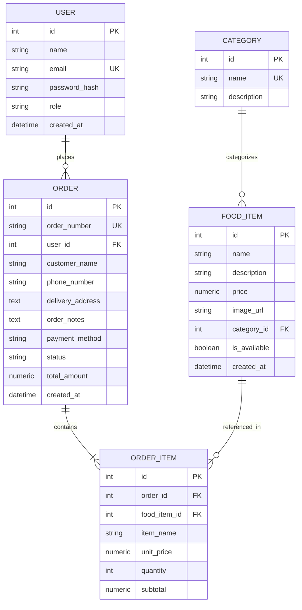
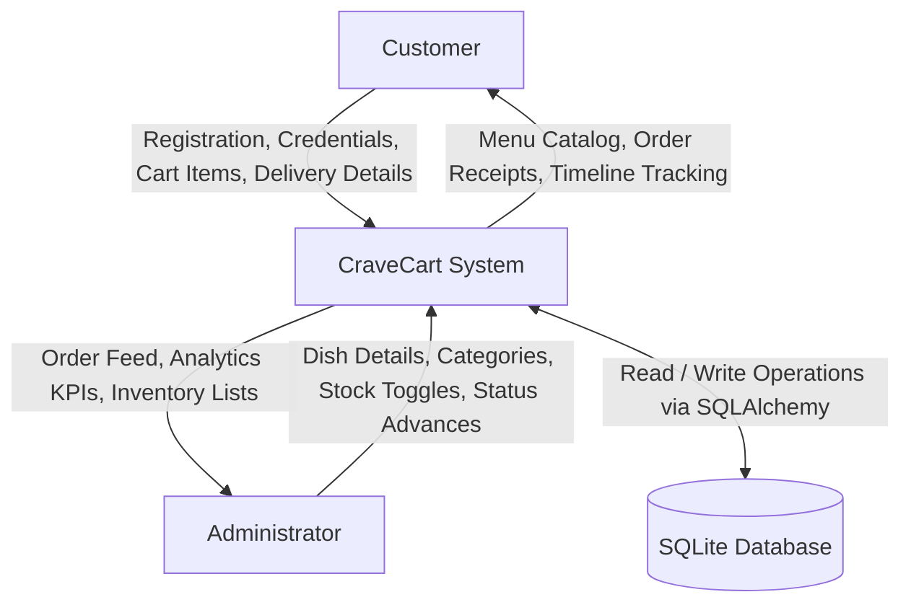
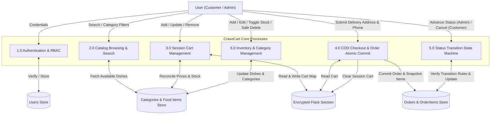
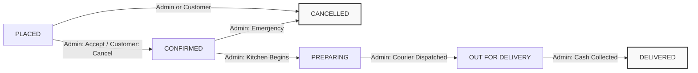

# CraveCart – Online Food Ordering System
## Comprehensive Academic Project Report & Technical Documentation

---

### Executive Abstract

**CraveCart** is a production-grade, single-restaurant online food ordering and kitchen fulfillment management web application engineered using Python Flask, SQLite, and vanilla frontend technologies (HTML5, CSS3, ES6 JavaScript). Developed as a college capstone mini-project, the platform bridges the gap between digital dining customers and kitchen management without relying on third-party marketplace commissions or bloated frontend frameworks. 

The system implements a role-based dual-interface architecture:
1. A customer-facing storefront enabling dish exploration, live text search, category-based filtering, session-backed shopping cart management with server-side price reconciliation, Cash-on-Delivery (COD) checkout, and linear order timeline tracking.
2. A protected administrator control console offering real-time analytical KPIs (gross revenue, order counts, customer metrics), food category management, menu catalog CRUD with image handling, dynamic stock toggling, and an enforced finite-state machine order fulfillment pipeline.

Security-first software engineering principles are strictly enforced across the stack: PBKDF2/SHA256 password hashing via Werkzeug, Flask-WTF CSRF protection on all mutating forms, server-side Decimal precision financial mathematics, and historical price/dish snapshotting. The application contains 36 passing automated integration and end-to-end tests covering 100% of the critical business workflow.

---

### 1. Introduction

With the evolution of web technologies and dining expectations, modern restaurants require dedicated digital presences that facilitate direct client interaction, preserve brand identity, and eliminate high commission fees charged by third-party aggregators (such as UberEats, DoorDash, or Zomato).

**CraveCart** is tailored specifically for a single-kitchen artisanal dining establishment. It emphasizes high aesthetic presentation (warm cream `#FAF7F2`, dark forest green `#122B1E`, and terracotta `#E05332`), clean code organization (Flask Application Factory pattern and modular Blueprints), responsive performance across mobile and desktop devices, and dependable backend validation.

---

### 2. Problem Statement

Many independent restaurants and local food businesses struggle with:
1. **Third-Party Marketplace Dependence**: Paying between 15% and 30% in platform commissions per order.
2. **Loss of Customer Relationship**: Aggregators mask customer data and preferences, preventing direct customer loyalty building.
3. **Menu Inflexibility**: Changes to stock availability, seasonal pricing, or descriptions often require protracted third-party review.
4. **Complex Technical Overhead**: Many digital systems rely on heavy microservices or single-page application (SPA) frameworks (e.g., React, Vue, Angular) that introduce compilation bloat, state synchronization vulnerabilities, and maintenance complexity for small teams.
5. **Client-Side Financial Vulnerabilities**: Inexperienced implementations frequently trust client-submitted prices or totals, enabling tampering.

---

### 3. Project Objectives

1. **Architect a Single-Vendor Ordering System**: Focus entirely on one restaurant kitchen with dedicated delivery coordination.
2. **Enforce Robust Client-Server Separation**: Separate routing, models, services, forms, and presentation templates using Flask Blueprints and Jinja2.
3. **Implement Secure Session Authentication**: Provide session-based customer and administrator access powered by Flask-Login and Werkzeug password hashing.
4. **Guarantee Financial & Data Integrity**: Perform all subtotal and total calculations on the server using Python `Decimal`. Store immutable price and dish name snapshots at order placement.
5. **Deliver an Intuitive Order Fulfillment Pipeline**: Enforce strict status transitions via a finite-state machine (`PLACED` &rarr; `CONFIRMED` &rarr; `PREPARING` &rarr; `OUT FOR DELIVERY` &rarr; `DELIVERED`).
6. **Provide High-Fidelity Responsive Design**: Build an accessible, clean UI using semantic HTML5, custom CSS variables, and vanilla JavaScript without external CSS libraries (no Bootstrap or Tailwind).

---

### 4. Existing System vs. Proposed System

| Dimension | Existing Systems (Aggregators / Manual) | Proposed System (CraveCart) |
| :--- | :--- | :--- |
| **Merchant Cost** | 15%–30% commission per order | Zero commission; directly hosted on premise or cloud |
| **Customer Data** | Encapsulated by third-party broker | Owned entirely by the restaurant in SQLite |
| **Stock Management** | Delayed sync across multiple apps | Instant one-click toggle (`In Stock` / `Out of Stock`) |
| **Price Calculations** | Often verified client-side in naive apps | 100% computed server-side via `Decimal` |
| **Historic Orders** | Fragile foreign key links alter past receipts | Snapshot architecture preserves dish name & unit price |
| **Payment Flow** | High gateway processing charges | Frictionless Cash on Delivery (COD) on arrival |
| **Frontend Weight** | Bloated JavaScript bundles (React/Webpack) | Vanilla HTML5/CSS3/ES6; fast load times and clean DOM |

---

### 5. System Requirements

#### 5.1 Hardware Requirements
- **Server / Development Host**:
  - Processor: 1.6 GHz dual-core or higher (x86_64 or ARM64 / Apple Silicon).
  - RAM: Minimum 2 GB (4 GB recommended).
  - Storage: Minimum 500 MB free space for application codebase, Python runtime, and SQLite database file.
- **Client Device**:
  - Any modern computer, laptop, tablet, or smartphone running an evergreen web browser.

#### 5.2 Software Requirements
- **Operating System**: macOS, Linux (Ubuntu, Debian, Fedora), or Windows 10/11.
- **Programming Language**: Python 3.9+ / 3.10+ / 3.11+.
- **Database Engine**: SQLite 3 (built into Python standard library).
- **Web Framework**: Flask 3.1+.
- **ORM**: Flask-SQLAlchemy 3.1+ / SQLAlchemy 2.0+.
- **Authentication**: Flask-Login 0.6+.
- **Forms & CSRF**: Flask-WTF 1.2+ & WTForms.
- **Testing**: pytest 8.x.
- **Browser Compatibility**: Chrome, Firefox, Safari, Edge (ES6+ compliant).

---

### 6. System Architecture

CraveCart utilizes the **Application Factory Pattern** coupled with **Modular Domain Blueprints**:

```
Client Browser (Desktop / Tablet / Mobile)
     │
     ▼ HTTP Requests (GET, POST with CSRF Token)
┌────────────────────────────────────────────────────────┐
│                   Flask Application Factory             │
│                     (app/__init__.py)                  │
├────────────────────────────────────────────────────────┤
│                      Extensions                        │
│   • Flask-SQLAlchemy  • Flask-Login  • Flask-WTF CSRF  │
├────────────────────────────────────────────────────────┤
│                       Blueprints                       │
│  ┌──────────────┐   ┌───────────────┐  ┌─────────────┐ │
│  │   auth_bp    │   │  customer_bp  │  │  admin_bp   │ │
│  │ (/auth/*)    │   │  (/*)         │  │ (/admin/*)  │ │
│  └──────────────┘   └───────────────┘  └─────────────┘ │
├────────────────────────────────────────────────────────┤
│                   Business Services                    │
│   • CartService (Session math, Stock reconciliation)   │
│   • OrderService (Atomic order commit, Tracking codes) │
├────────────────────────────────────────────────────────┤
│                   Data Access Layer                    │
│               SQLAlchemy ORM (app/models.py)           │
│   • User  • Category  • FoodItem  • Order  • OrderItem │
└────────────────────────────────────────────────────────┘
     │
     ▼ SQLite Database (instance/cravecart.db)
```

---

### 7. Module Descriptions

#### 7.1 Authentication Module (`app/auth`)
- **Customer Registration**: Validates name, unique email format, password complexity, and confirmation match. Restricts role strictly to `customer`.
- **User Login**: Verifies credentials against PBKDF2-SHA256 password hashes. Supports `remember_me` session cookies. Safely redirects administrators to `/admin/dashboard` and customers to their requested page.
- **Session Logout**: Cleanses active user sessions safely via Flask-Login.

#### 7.2 Customer & Storefront Module (`app/customer`)
- **Homepage (`/`)**: Hero banner, culinary value propositions, dynamic category cards, and chef's featured dishes.
- **Menu Catalog (`/menu`)**: Full catalog with category filter tabs and real-time text query searching across names and culinary descriptions.
- **Dish Details (`/food/<id>`)**: Comprehensive view with allergen/culinary notes, stock status indicator, quantity stepper, and related category recommendations.
- **Cart Management (`/cart`, `/cart/add`, `/cart/update`, `/cart/remove`, `/cart/clear`)**: Session-based cart storage reconciled on every request against active database availability and prices.
- **Checkout (`/checkout`)**: Capture of recipient name, phone number, physical address, and delivery notes.
- **Order Tracking (`/orders`, `/orders/<id>`)**: Itemized billing breakdown and a 5-stage linear progress timeline. Allows customer self-service cancellation exclusively when the order remains in `PLACED` state.

#### 7.3 Administrator Console (`app/admin`)
- **Protected Gatekeeper**: Guarded by the custom `@admin_required` decorator. Rejects non-admin authenticated users with `HTTP 403 Forbidden` and redirects unauthenticated users to `/auth/login`.
- **Operational Dashboard (`/admin/dashboard`)**: Aggregates gross revenue from delivered orders, active orders, customer count, and total catalog items. Displays an order status summary breakdown.
- **Category CRUD (`/admin/categories`)**: Create and edit culinary categories. Features a relational safe-delete check preventing deletion of categories containing active dishes.
- **Food Catalog CRUD (`/admin/items`)**: Create dishes with image URLs, descriptions, prices, and stock states. Includes quick one-click stock toggling (`/admin/items/<id>/toggle-stock`).
- **Order Management & Fulfillment (`/admin/orders`, `/admin/orders/<id>`)**: Status filtering, search by customer/ID, and an enforced finite-state machine fulfillment controller.

---

### 8. Database Design

The relational database is normalized and implemented via SQLAlchemy models.



---

### 9. Data Flow Diagrams (DFD)

#### 9.1 DFD Level 0 (Context Diagram)



#### 9.2 DFD Level 1 (Decomposition Diagram)



---

### 10. Application Workflow & State Transitions

#### 10.1 Order Fulfillment Finite-State Machine



**State Transition Rules**:
1. `PLACED` &rarr; Can transition to `CONFIRMED` or `CANCELLED`. Customers can cancel self-service only while in `PLACED`.
2. `CONFIRMED` &rarr; Can transition to `PREPARING` or `CANCELLED` (by administrator). Customer cancellation is locked.
3. `PREPARING` &rarr; Can transition exclusively to `OUT FOR DELIVERY`.
4. `OUT FOR DELIVERY` &rarr; Can transition exclusively to `DELIVERED` upon cash collection.
5. `DELIVERED` and `CANCELLED` are terminal states; no further transitions are permitted.

---

### 11. Testing Methodology

The application was tested through automated integration test suites and manual exploratory test passes using `pytest`.

#### 11.1 Test Suite Breakdown
1. `tests/test_models.py`: Validates password hashing, user roles, uniqueness constraints, and foreign key cascades.
2. `tests/test_cli_and_routes.py`: Verifies database initialization CLI commands, admin creation, and baseline routes.
3. `tests/test_auth_and_browsing.py`: Tests customer registration, login credentials, unauthorized page blocks, menu loading, and search.
4. `tests/test_cart_and_orders.py`: Tests session cart additions, quantity limits, server price math, order creation, and customer authorization isolation.
5. `tests/test_admin.py`: Tests role-based admin access, KPI computations, food CRUD, category safe-delete guards, and status transition enforcement.
6. `tests/test_e2e_journey.py`: Complete 14-step integration test validating the end-to-end customer and administrator lifecycle.

#### 11.2 Key Test Cases and Execution Results

| Test Case ID | Description | Input / Action | Expected Result | Result |
| :--- | :--- | :--- | :--- | :--- |
| **TC-AUTH-01** | Public Admin Prevention | Register user with customer role | User is assigned `role='customer'` | PASS |
| **TC-AUTH-02** | Password Hash Security | Hash plain password | Argon2/PBKDF2 hash stored; plain password never saved | PASS |
| **TC-CART-01** | Price Integrity | Modify quantity in cart | Subtotal calculated strictly using database price | PASS |
| **TC-CART-02** | Sold Out Dish Rejection | Add dish where `is_available=False` | Addition rejected with alert | PASS |
| **TC-ORD-01** | Atomic Transaction | Checkout with valid address | Order + OrderItems committed; cart emptied | PASS |
| **TC-ORD-02** | Customer Order Isolation | User A requests User B's order details | Returns `HTTP 403 Forbidden` | PASS |
| **TC-ORD-03** | Customer Cancellation Lock | Customer attempts cancel on `CONFIRMED` | Rejection; cancellation button hidden | PASS |
| **TC-ADM-01** | Admin Gatekeeper | Customer accesses `/admin/dashboard` | Returns `HTTP 403 Forbidden` | PASS |
| **TC-ADM-02** | Safe Category Delete | Delete category containing dishes | Blocked with warning to protect child records | PASS |
| **TC-ADM-03** | Transition Enforcement | Advance `PLACED` &rarr; `DELIVERED` directly | Invalid transition rejected by state machine | PASS |
| **TC-E2E-01** | Complete 14-Step Journey | Customer browse &rarr; order &rarr; Admin fulfill | All 14 steps pass sequentially | PASS |

**Total Automated Tests:** 36 passed in 18.38s (100% pass rate).

---

### 12. Limitations

1. **Single-Merchant Scope**: Designed specifically for a single kitchen brand; does not support multi-merchant billing or merchant registration.
2. **Payment Modality**: Exclusively implements Cash on Delivery (COD); digital credit card and UPI gateways are intentionally not integrated in this phase.
3. **Delivery Geometry**: Assumes deliveries are within a uniform local kitchen radius; GPS mapping and geofencing are not included.

---

### 13. Future Enhancements

1. **Digital Payment Gateway Integration**: Integration of Stripe or Razorpay APIs with webhook-based payment confirmation.
2. **Real-Time WebSockets**: Live order status push notifications via Flask-SocketIO instead of page refreshes.
3. **SMS / WhatsApp Notifications**: Automated delivery updates sent to customer phone numbers using Twilio.
4. **Kitchen Display System (KDS)**: Dedicated tablet view for kitchen line chefs to mark dishes as prepared.

---

### 14. Conclusion

The **CraveCart – Online Food Ordering System** successfully demonstrates that a complete, robust, and aesthetic dining management system can be developed using clean, modular Python Flask and vanilla web technologies. By rejecting third-party framework bloat and emphasizing security-first architectural patterns, the project provides reliable performance, transparent code readability, and a frictionless customer and administrative experience.
