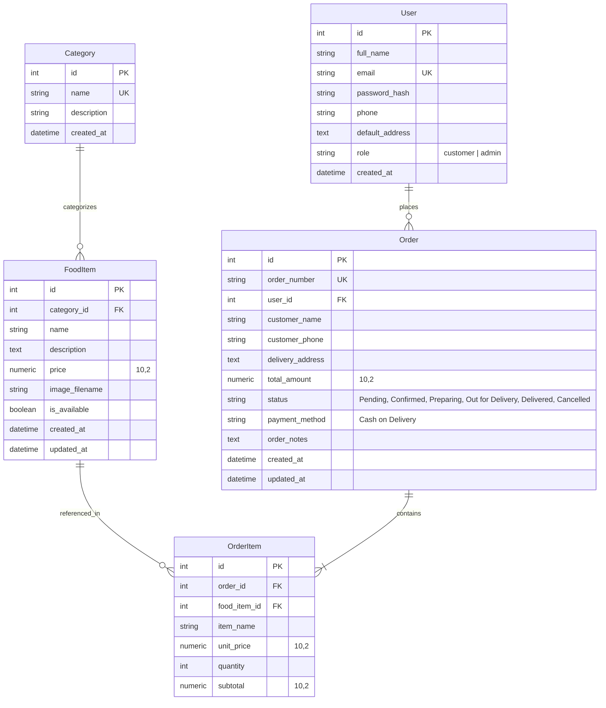
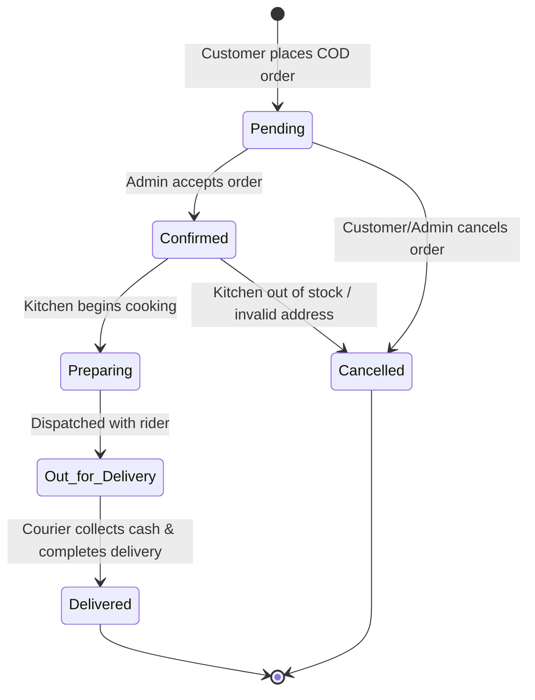

# CraveCart – Online Food Ordering System
## Comprehensive Technical Project Specification (PROJECT_SPEC.md)

---

## 1. Project Overview & Scope

### 1.1 Objective
**CraveCart** is a production-grade, modular web application designed for a single-restaurant online food ordering service. Built with Python Flask, SQLite, and vanilla frontend technologies, the system allows customers to explore curated food menus, customize cart quantities, place Cash-on-Delivery (COD) orders, and monitor real-time order progression. Concurrently, it grants restaurant administrators an intuitive control dashboard to manage categories, menu items, stock status, and customer order fulfillment.

### 1.2 Target Audience & Roles
1. **Customer**:
   - Discovers menu offerings categorized by cuisine/type.
   - Performs text search and category-based filtering.
   - Manages personal shopping cart with dynamic item quantity adjustments.
   - Checks out using Cash on Delivery (COD) with custom delivery details.
   - Tracks order history and real-time status updates (Pending → Confirmed → Preparing → Out for Delivery → Delivered / Cancelled).
2. **Administrator**:
   - Accesses a protected administration panel via role-based access control.
   - Views key operational metrics (total revenue, active orders, total menu items, user count).
   - Manages food categories and menu items (Create, Read, Update, Delete) with image uploads.
   - Toggles item availability (in stock / out of stock) dynamically.
   - Oversees customer orders, inspects itemized receipts, and transitions order fulfillment statuses.

### 1.3 Scope Boundaries & Non-Functional Constraints
- **Single-Vendor Model**: Tailored specifically for a single restaurant brand with one central kitchen and delivery zone. No multi-merchant logic.
- **Payment Method**: Strictly Cash on Delivery (COD). No third-party payment gateway integration.
- **Zero Third-Party UI Frameworks**: Pure HTML5, modern CSS3 (Flexbox/CSS Grid/Custom Properties), and vanilla ES6+ JavaScript. No React, Vue, Tailwind, or Bootstrap bloat.
- **Architectural Discipline**: Strict separation of concerns (Application Factory pattern, Blueprints, Service/Helper modules, WTForms, and SQLAlchemy ORM models).
- **Security-First Architecture**: Backend-enforced validation, server-side price recalculation, parameterized queries via ORM, CSRF protection on all mutating forms, and secure password hashing.

---

## 2. Technology Stack & Environment

| Layer | Technology / Library | Purpose |
| :--- | :--- | :--- |
| **Backend Framework** | Python 3.10+ / Flask 3.x | Lightweight, high-performance WSGI web application framework |
| **Database Engine** | SQLite 3 | Embedded, file-based relational database |
| **ORM & Migrations** | Flask-SQLAlchemy 3.x | Declarative object-relational mapping and database abstraction |
| **Authentication** | Flask-Login 0.6+ | Session-based user authentication and user session management |
| **Form Handling & CSRF** | Flask-WTF 1.2+ & WTForms | Server-side form validation, sanitization, and CSRF token verification |
| **Security & Hashing** | Werkzeug Security | Argon2/PBKDF2-SHA256 password hashing and timing-safe comparisons |
| **Frontend Layout** | HTML5 Semantic Elements | Accessible and standard document structuring |
| **Frontend Styling** | Custom CSS3 (Variables, Flexbox, Grid) | Custom warm cream, dark green, and terracotta visual identity |
| **Client Scripting** | Vanilla JavaScript (ES6+) | Asynchronous cart modifications, flash dismissals, search filters |
| **Environment Config** | Python-Dotenv | Decoupled secrets management via `.env` |

---

## 3. High-Level Architecture & Project Structure

The project employs the **Flask Application Factory Pattern** combined with **Modular Blueprints**. This isolates concerns into discrete domain modules (`auth`, `main`, `cart`, `orders`, `admin`), avoiding circular dependencies and facilitating automated testing.

```
Online food ordering system/
├── .env.example                 # Template for environment variables
├── .gitignore                   # Files and directories excluded from Git
├── README.md                    # Project run guide and technical overview
├── PROJECT_SPEC.md              # Complete technical architecture specification
├── IMPLEMENTATION_LOG.md        # Milestone progress tracker
├── requirements.txt             # Python dependencies
├── run.py                       # Application entrypoint
├── instance/
│   └── cravecart.db             # SQLite database instance (git-ignored)
└── app/
    ├── __init__.py              # Application factory (create_app)
    ├── config.py                # Configuration classes (Dev, Test, Prod)
    ├── extensions.py            # Instantiated Flask extensions (db, login_manager, csrf)
    ├── models/
    │   ├── __init__.py          # Model exports
    │   ├── user.py              # User entity and role definitions
    │   ├── category.py          # Food category entity
    │   ├── food_item.py         # Menu item entity with availability & pricing
    │   ├── order.py             # Order header entity and status enum
    │   └── order_item.py        # Itemized snapshot entity for completed orders
    ├── forms/
    │   ├── __init__.py          # Form exports
    │   ├── auth_forms.py        # Login and Registration forms
    │   ├── admin_forms.py       # Food item, Category, and Status update forms
    │   └── order_forms.py       # Checkout delivery details form
    ├── routes/
    │   ├── __init__.py          # Blueprint registrations
    │   ├── auth.py              # Authentication endpoints (/auth/login, /auth/register, etc.)
    │   ├── main.py              # Public customer catalog and detail views (/, /menu, /food/<id>)
    │   ├── cart.py              # Session cart mutation endpoints (/cart, /cart/add, etc.)
    │   ├── orders.py            # Checkout and tracking views (/orders/checkout, /orders/<id>)
    │   └── admin.py             # Protected admin dashboard and management (/admin/*)
    ├── services/
    │   ├── __init__.py          # Service exports
    │   ├── cart_service.py      # Session-based cart math and database reconciliation
    │   └── order_service.py     # Atomic order creation, price verification, and stats aggregation
    ├── utils/
    │   ├── __init__.py          # Utility exports
    │   ├── decorators.py        # Custom decorators (e.g., @admin_required)
    │   └── file_upload.py       # Secure image handling and thumbnail/filename sanitization
    ├── static/
    │   ├── css/
    │   │   ├── main.css         # Global design system, typography, reset, variables
    │   │   ├── customer.css     # Catalog, food card grid, and cart styling
    │   │   ├── admin.css        # Dashboard tables, stat cards, and management forms
    │   │   └── responsive.css   # Media queries for tablet and mobile devices
    │   ├── js/
    │   │   ├── cart.js          # Cart counter badges, quantity steppers, AJAX sync
    │   │   ├── search.js        # Live filtering by keyword and category pills
    │   │   └── admin.js         # Confirmations and dynamic order status updates
    │   ├── images/
    │   │   ├── placeholder.jpg  # Fallback image for food items without photos
    │   │   └── uploads/         # User-uploaded food photography
    └── templates/
        ├── base.html            # Primary layout template with navbar, flash messages, footer
        ├── auth/
        │   ├── login.html       # Customer & Admin login interface
        │   └── register.html    # Customer registration interface
        ├── main/
        │   ├── index.html       # Hero landing page & featured items
        │   ├── menu.html        # Filterable and searchable menu catalog
        │   └── food_detail.html # Rich food detail view with ingredient notes
        ├── cart/
        │   └── view_cart.html   # Detailed shopping cart review table
        ├── orders/
        │   ├── checkout.html    # Address, contact details, and COD confirmation
        │   ├── history.html     # Past order listing with quick links
        │   └── detail.html      # Order timeline and itemized receipt
        ├── admin/
        │   ├── base_admin.html  # Dedicated admin layout with sidebar navigation
        │   ├── dashboard.html   # Metric summary cards and recent order feed
        │   ├── categories.html  # Category listing and inline addition modal/form
        │   ├── category_edit.html
        │   ├── items.html       # Food inventory table with toggle switches
        │   ├── item_form.html   # Add/Edit food item form with image preview
        │   ├── orders.html      # Comprehensive order management table
        │   └── order_detail.html# Admin view to inspect and modify order status
        └── errors/
            ├── 403.html         # Forbidden access
            ├── 404.html         # Resource not found
            └── 500.html         # Internal server error
```

---

## 4. Database Schema & Data Dictionary

### 4.1 Entity Relationship Diagram (ERD)



### 4.2 Detailed Data Dictionary

#### 4.2.1 Table: `users`
Stores user profile, authentication credentials, and permission role.

| Column | Type | Constraints | Description |
| :--- | :--- | :--- | :--- |
| `id` | INTEGER | PRIMARY KEY, AUTOINCREMENT | Unique user identifier |
| `full_name` | VARCHAR(100) | NOT NULL | User's full legal or preferred name |
| `email` | VARCHAR(120) | UNIQUE, NOT NULL, INDEX | Primary email address used for credentials |
| `password_hash` | VARCHAR(255) | NOT NULL | Salted cryptographic password hash |
| `phone` | VARCHAR(20) | NOT NULL | Contact number for delivery fulfillment |
| `default_address` | TEXT | NULLABLE | Saved delivery address for expedited checkout |
| `role` | VARCHAR(20) | NOT NULL, DEFAULT 'customer' | System authorization role: `'customer'` or `'admin'` |
| `created_at` | DATETIME | NOT NULL, DEFAULT CURRENT_TIMESTAMP | Registration timestamp |

#### 4.2.2 Table: `categories`
Organizes menu offerings into logical sections (e.g., Starters, Main Course, Beverages, Desserts).

| Column | Type | Constraints | Description |
| :--- | :--- | :--- | :--- |
| `id` | INTEGER | PRIMARY KEY, AUTOINCREMENT | Unique category identifier |
| `name` | VARCHAR(50) | UNIQUE, NOT NULL | Display name of the category |
| `description` | VARCHAR(255) | NULLABLE | Brief culinary summary of the category |
| `created_at` | DATETIME | NOT NULL, DEFAULT CURRENT_TIMESTAMP | Record creation timestamp |

#### 4.2.3 Table: `food_items`
Contains individual food and beverage items available in the catalog.

| Column | Type | Constraints | Description |
| :--- | :--- | :--- | :--- |
| `id` | INTEGER | PRIMARY KEY, AUTOINCREMENT | Unique food item identifier |
| `category_id` | INTEGER | FOREIGN KEY (`categories.id`), NOT NULL | Owning category |
| `name` | VARCHAR(120) | NOT NULL, INDEX | Title of the dish |
| `description` | TEXT | NULLABLE | Detailed description and dietary notes |
| `price` | NUMERIC(10, 2)| NOT NULL | Unit retail price |
| `image_filename`| VARCHAR(255) | NULLABLE | Stored file name inside `static/images/uploads/` |
| `is_available` | BOOLEAN | NOT NULL, DEFAULT TRUE, INDEX | In-stock / active availability toggle |
| `created_at` | DATETIME | NOT NULL, DEFAULT CURRENT_TIMESTAMP | Record creation timestamp |
| `updated_at` | DATETIME | NOT NULL, DEFAULT CURRENT_TIMESTAMP | Record modification timestamp |

#### 4.2.4 Table: `orders`
Represents an individual checkout transaction and lifecycle state.

| Column | Type | Constraints | Description |
| :--- | :--- | :--- | :--- |
| `id` | INTEGER | PRIMARY KEY, AUTOINCREMENT | Internal primary key |
| `order_number` | VARCHAR(24) | UNIQUE, NOT NULL, INDEX | Human-readable identifier (e.g. `CRV-20261109-A4F9`) |
| `user_id` | INTEGER | FOREIGN KEY (`users.id`), NOT NULL | Placed by user reference |
| `customer_name` | VARCHAR(100) | NOT NULL | Name at delivery time (snapshot from form) |
| `customer_phone`| VARCHAR(20) | NOT NULL | Phone at delivery time (snapshot from form) |
| `delivery_address`| TEXT | NOT NULL | Physical destination for courier |
| `total_amount` | NUMERIC(10, 2)| NOT NULL | Final order sum, computed on server |
| `status` | VARCHAR(30) | NOT NULL, DEFAULT 'Pending' | Current fulfillment state |
| `payment_method`| VARCHAR(30) | NOT NULL, DEFAULT 'Cash on Delivery' | Selected payment modality |
| `order_notes` | TEXT | NULLABLE | Special preparation or delivery notes |
| `created_at` | DATETIME | NOT NULL, DEFAULT CURRENT_TIMESTAMP | Order submission timestamp |
| `updated_at` | DATETIME | NOT NULL, DEFAULT CURRENT_TIMESTAMP | Last status transition timestamp |

#### 4.2.5 Table: `order_items`
Stores the exact items, historical prices, and quantities for an order.

| Column | Type | Constraints | Description |
| :--- | :--- | :--- | :--- |
| `id` | INTEGER | PRIMARY KEY, AUTOINCREMENT | Line item identifier |
| `order_id` | INTEGER | FOREIGN KEY (`orders.id`), ON DELETE CASCADE | Owning order |
| `food_item_id` | INTEGER | FOREIGN KEY (`food_items.id`), ON DELETE SET NULL | Reference to current food item |
| `item_name` | VARCHAR(120) | NOT NULL | Historical snapshot of dish title |
| `unit_price` | NUMERIC(10, 2)| NOT NULL | Historical snapshot of unit price |
| `quantity` | INTEGER | NOT NULL | Quantity ordered (minimum 1) |
| `subtotal` | NUMERIC(10, 2)| NOT NULL | Computed line total (`unit_price * quantity`) |

---

## 5. Security & Authentication Architecture

### 5.1 Password Hashing & Management
- Passwords are encrypted before storage using `werkzeug.security.generate_password_hash(password, method='pbkdf2:sha256', salt_length=16)`.
- Verification utilizes `werkzeug.security.check_password_hash(user.password_hash, candidate_password)` to prevent timing analysis attacks.
- Passwords must meet validation constraints: minimum 8 characters, containing at least one numerical digit and one alphabetical character.

### 5.2 Role-Based Access Control (RBAC)
- The `User` model exposes helper properties:
  ```python
  @property
  def is_admin(self):
      return self.role == 'admin'
  ```
- All administrative routes are protected with a custom `@admin_required` decorator:
  ```python
  from functools import wraps
  from flask import abort
  from flask_login import current_user, login_required

  def admin_required(f):
      @wraps(f)
      @login_required
      def decorated_function(*args, **kwargs):
          if not current_user.is_authenticated or not current_user.is_admin:
              abort(403)
          return f(*args, **kwargs)
      return decorated_function
  ```

### 5.3 Anti-Tampering & Financial Verification Policy
- **Never Trust Client-Side Calculations**: The frontend shopping cart stores only item IDs and requested counts.
- Upon checkout submission, the server re-fetches each `FoodItem` directly from the SQLite database.
- The server checks whether `food_item.is_available` is `True`.
- The total amount is computed strictly via:
  $$\text{Total} = \sum_{i=1}^{n} (\text{db\_price}_i \times \text{requested\_quantity}_i)$$
- Client-submitted totals or altered form payloads are completely ignored.

### 5.4 CSRF Protection & Form Sanitization
- `Flask-WTF` automatically attaches unique CSRF tokens to all WTForms.
- Vanilla JavaScript `fetch` requests include the CSRF token via the standard `X-CSRFToken` request header.
- Text inputs are trimmed and escaped to guard against Cross-Site Scripting (XSS).

---

## 6. Route & Endpoint Catalog

### 6.1 Authentication Blueprint (`auth_bp` – prefix: `/auth`)

| HTTP Method | Route | Endpoint Name | Auth Req. | Description |
| :--- | :--- | :--- | :--- | :--- |
| `GET`, `POST` | `/auth/register` | `auth.register` | Anonymous | Customer account registration |
| `GET`, `POST` | `/auth/login` | `auth.login` | Anonymous | Session authentication for customers and admins |
| `POST` | `/auth/logout` | `auth.logout` | Logged In | Destroys user session; redirects to home |

### 6.2 Customer Catalog Blueprint (`main_bp` – prefix: `/`)

| HTTP Method | Route | Endpoint Name | Auth Req. | Description |
| :--- | :--- | :--- | :--- | :--- |
| `GET` | `/` | `main.index` | Public | Landing page showcasing hero banner, top dishes, categories |
| `GET` | `/menu` | `main.menu` | Public | Full catalog with category tabs, search query parameter, and availability |
| `GET` | `/food/<int:item_id>` | `main.food_detail`| Public | Detailed view of a single dish with ingredient description |

### 6.3 Shopping Cart Blueprint (`cart_bp` – prefix: `/cart`)

| HTTP Method | Route | Endpoint Name | Auth Req. | Description |
| :--- | :--- | :--- | :--- | :--- |
| `GET` | `/cart` | `cart.view_cart` | Public | Cart review page displaying items, item prices, subtotal |
| `POST` | `/cart/add` | `cart.add_item` | Public | Adds food item with specified quantity to session cart |
| `POST` | `/cart/update` | `cart.update_item`| Public | Updates quantity for a specific item (supports increment/decrement) |
| `POST` | `/cart/remove` | `cart.remove_item`| Public | Deletes a line item from the session cart |
| `POST` | `/cart/clear` | `cart.clear_cart` | Public | Completely empties current session cart |

### 6.4 Orders & Checkout Blueprint (`orders_bp` – prefix: `/orders`)

| HTTP Method | Route | Endpoint Name | Auth Req. | Description |
| :--- | :--- | :--- | :--- | :--- |
| `GET`, `POST` | `/orders/checkout` | `orders.checkout` | Customer | Displays delivery form, validates, verifies prices, creates order |
| `GET` | `/orders/history` | `orders.history` | Customer | Lists past orders placed by the authenticated customer |
| `GET` | `/orders/<int:order_id>`| `orders.detail` | Customer (Owner) | Displays detailed receipt and status progress bar |

### 6.5 Admin Blueprint (`admin_bp` – prefix: `/admin`)

| HTTP Method | Route | Endpoint Name | Auth Req. | Description |
| :--- | :--- | :--- | :--- | :--- |
| `GET` | `/admin/dashboard` | `admin.dashboard` | Admin | Displays revenue, order counts, status breakdowns, recent activity |
| `GET` | `/admin/categories`| `admin.categories` | Admin | Lists all food categories with creation form |
| `POST` | `/admin/categories/add`| `admin.category_add`| Admin | Handles creation of new food category |
| `POST` | `/admin/categories/<int:cat_id>/edit`| `admin.category_edit`| Admin | Modifies category title and description |
| `POST` | `/admin/categories/<int:cat_id>/delete`| `admin.category_delete`| Admin | Deletes empty category (verifies zero associated items) |
| `GET` | `/admin/items` | `admin.items` | Admin | Inventory table listing all items with availability toggles |
| `GET`, `POST` | `/admin/items/new` | `admin.item_create`| Admin | Form to upload photo, assign category, set price and description |
| `GET`, `POST` | `/admin/items/<int:item_id>/edit`| `admin.item_edit`| Admin | Form to modify item metadata and replace photography |
| `POST` | `/admin/items/<int:item_id>/toggle-status`| `admin.item_toggle`| Admin | Quick toggle for in-stock / out-of-stock state |
| `POST` | `/admin/items/<int:item_id>/delete`| `admin.item_delete`| Admin | Removes food item from catalog |
| `GET` | `/admin/orders` | `admin.orders` | Admin | Filterable orders table (filter by status, date) |
| `GET` | `/admin/orders/<int:order_id>`| `admin.order_detail`| Admin | Detailed order audit view with customer info and items |
| `POST` | `/admin/orders/<int:order_id>/status`| `admin.update_status`| Admin | Transitions order state to next phase |

---

## 7. Business Logic & Cart Lifecycle

### 7.1 Session Cart Structure
The cart is maintained in Flask's encrypted client-side session (`flask.session`), eliminating database bloat for abandoned carts:

```python
session['cart'] = {
    "14": {"quantity": 2},
    "7": {"quantity": 1}
}
```

### 7.2 Cart Mathematical Reconciliation
When rendering `/cart` or executing checkout:
1. Extract list of item ID keys: `[int(id) for id in session['cart'].keys()]`.
2. Query `FoodItem.query.filter(FoodItem.id.in_(keys)).all()`.
3. Discard any item that has been deleted from the database.
4. Mark items where `is_available == False` as unavailable (blocking checkout until removed or restocked).
5. Compute line item subtotal: $\text{price} \times \text{quantity}$.
6. Sum grand total.

### 7.3 Order Lifecycle & State Machine



#### Transition Rules:
- **Pending**: Order placed by customer; awaiting restaurant acceptance.
- **Confirmed**: Restaurant acknowledges order; kitchen queued.
- **Preparing**: Meal is actively being cooked.
- **Out for Delivery**: Food is packed and with the delivery agent.
- **Delivered**: Handed over to customer; Cash on Delivery payment collected. Terminal state.
- **Cancelled**: Terminated either before preparation or due to customer request. Terminal state.

---

## 8. Frontend Design System & UI/UX Guidelines

### 8.1 Visual Theme & Color Palette
The visual design embodies an artisanal, modern culinary identity:

```css
:root {
  /* Primary & Brand */
  --color-primary-dark: #163829;     /* Deep forest green for headers, primary buttons */
  --color-primary-medium: #234E35;   /* Secondary green for badges, accents */
  --color-primary-light: #EBF3EE;    /* Soft mint tint for light active states */

  /* Accents */
  --color-accent-terracotta: #D9532F; /* Warm terracotta/orange for CTAs, price tags */
  --color-accent-hover: #BF4422;      /* Darker shade for interactive button hover */
  --color-accent-soft: #FDEEE9;       /* Light tint for alerts, badges */

  /* Neutrals & Surfaces */
  --color-bg-cream: #FAF6EE;          /* Warm artisan cream page background */
  --color-surface-white: #FFFFFF;     /* Pure card and container background */
  --color-surface-elevated: #F4EFE6;  /* Elevated table headers, category pills */
  --color-border-subtle: #E8E2D5;     /* Delicate border divider */

  /* Text & Typography */
  --color-text-primary: #1C2420;      /* High contrast dark slate for titles and body */
  --color-text-secondary: #5C6962;    /* Balanced secondary text for descriptions */
  --color-text-muted: #8F9D95;        /* Muted captions, timestamps */

  /* Status Colors */
  --status-pending: #E09F3E;
  --status-confirmed: #3D73D4;
  --status-preparing: #8E44AD;
  --status-out-for-delivery: #D9532F;
  --status-delivered: #2E7D32;
  --status-cancelled: #C62828;

  /* Typography */
  --font-family-sans: -apple-system, BlinkMacSystemFont, "Segoe UI", Roboto, "Helvetica Neue", Arial, sans-serif;
  
  /* Shadows & Radius */
  --radius-sm: 6px;
  --radius-md: 10px;
  --radius-lg: 16px;
  --radius-full: 9999px;
  --shadow-subtle: 0 2px 8px rgba(22, 56, 41, 0.05);
  --shadow-card: 0 4px 16px rgba(22, 56, 41, 0.08);
  --shadow-elevated: 0 12px 28px rgba(22, 56, 41, 0.12);
  --transition-smooth: all 0.25s cubic-bezier(0.4, 0, 0.2, 1);
}
```

### 8.2 Component Architecture
- **Navbar**: Brand logo with leaf/cloche glyph, catalog links, category drop, dynamic cart icon with badge counter, user avatar/dropdown.
- **Hero Section**: High-impact editorial headline, quick category search pills, restaurant operating hours badge.
- **Food Card**: Image with aspect-ratio container, title, concise description, dynamic vegetarian/availability indicator, price in terracotta bold, and animated "Add to Cart" button.
- **Cart Drawer/Page**: Line items with thumbnail, item name, unit price, quantity stepper `[-] [count] [+]`, remove icon, subtotal, and checkout CTA.
- **Order Tracking Progress Bar**: Step indicator with animated pulse on current active state.
- **Admin Dashboard**: Metric summary cards (Total Revenue, Orders Today, Active Orders, Menu Catalog Size), interactive order status tables, and quick-action menu management.

---

## 9. Quality Assurance & Testing Plan

### 9.1 Unit Testing Strategy (`pytest` / `unittest`)
1. **Model Tests**:
   - User password encryption and comparison accuracy.
   - User role properties (`is_admin`, `is_customer`).
   - Category-to-FoodItem cascade rules.
   - Order-to-OrderItem total recalculations.
2. **Cart Service Tests**:
   - Adding non-existent item IDs returns validation error.
   - Incrementing and decrementing quantities respects boundary limits ($1 \leq q \leq 50$).
   - Cart subtotal accurately recalculates when item unit price changes in database.
3. **Security & Authorization Tests**:
   - Anonymous user visiting `/admin/*` redirects to `/auth/login`.
   - Customer account visiting `/admin/*` raises HTTP 403 Forbidden.
   - Tampered form payload with altered unit prices is rejected or ignored.

### 9.2 Manual Acceptance Checklist
- [ ] User can register a customer account with valid phone and email.
- [ ] Registered user can log in and view their personal profile info.
- [ ] Anonymous user can browse menu, search dishes, and filter by categories.
- [ ] Adding an item updates the navbar cart badge counter without errors.
- [ ] Out-of-stock items cannot be added to cart.
- [ ] Modifying quantities in cart updates subtotal and total synchronously.
- [ ] Customer can checkout with COD, providing delivery address and phone number.
- [ ] Submitting checkout creates an order record and clears the active session cart.
- [ ] Customer can track order timeline through all progressive statuses.
- [ ] Admin can log in, access `/admin/dashboard`, and view newly placed orders.
- [ ] Admin can create a new category and upload a new food item with an image.
- [ ] Admin can toggle food item availability from In Stock to Out of Stock.
- [ ] Admin can transition order status from Pending to Delivered.
- [ ] Layout renders responsively on Mobile (375px), Tablet (768px), and Desktop (1280px+).

---

## 10. Project Milestones & Delivery Phases

| Phase | Milestone | Deliverables | Status |
| :---: | :--- | :--- | :---: |
| **0** | **Architecture & Specifications** | `PROJECT_SPEC.md`, `IMPLEMENTATION_LOG.md`, Directory Plan | Completed |
| **1** | **Foundation & Modular Core** | Flask Factory, `config.py`, Extensions, DB Schema Models, Base Templates & CSS System | Planned |
| **2** | **Authentication & Roles** | Register, Login, Logout, `@admin_required`, Flash messaging, Admin seeding | Planned |
| **3** | **Menu Catalog & Public Views** | Category management, Food item display, Category pills, Search bar, Food detail view | Planned |
| **4** | **Cart Engine & Operations** | Session cart service, Add/Update/Remove routes, Dynamic badge, Cart review page | Planned |
| **5** | **Checkout & Order Processing** | Checkout WTForm, Server-side price verification, Atomic order generation, COD receipt | Planned |
| **6** | **Customer Order Tracking** | Order history table, Individual order timeline view with graphical progress tracker | Planned |
| **7** | **Admin Dashboard & Management** | Admin statistics cards, Category CRUD, Food Item CRUD with image upload, Stock toggle | Planned |
| **8** | **Admin Order Fulfillment** | Filterable orders table, Detailed order view, Status transition workflow | Planned |
| **9** | **Testing, Polish & Handover** | Unit test suite, Responsive CSS audit, Empty-state styling, Final validation | Planned |
